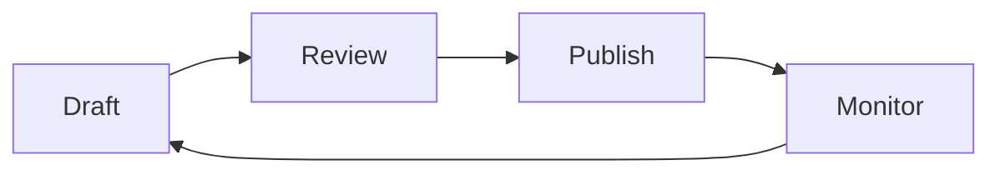

## Overview

Use this page as a starter kit for organizing documentation in a way that stays easy to scale. You can adapt the structure, workflows, and examples to match your own product, team, and editorial process for rohit singh.

Good content management helps you keep your docs consistent, reduce duplication, and make updates safer. It also gives contributors a clear path for adding new pages, reviewing changes, and keeping related content connected.

<Callout kind="info">
This is a starter kit template. Replace the sample structure and examples with the conventions your team uses.
</Callout>

## Content structure

A simple hierarchy makes documentation easier to navigate and maintain. Start with a small set of top-level pages, then break each topic into focused subpages. This keeps each page narrow enough to read quickly while still giving readers a clear path to related material.

Use this pattern when you plan your docs:

<Columns cols={2}>
  <Card title="Page hierarchy" icon="book-open" href="/introduction">
    Group pages by topic so readers can move from broad concepts to specific tasks.
  </Card>
  <Card title="Draft workflow" icon="edit-3" href="/quickstart">
    Keep draft pages separate from published content until they are reviewed.
  </Card>
  <Card title="Related links" icon="arrow-right" href="/authentication">
    Connect pages with clear links so readers can continue their journey naturally.
  </Card>
  <Card title="Maintenance" icon="settings" href="/changelog">
    Review content regularly to keep examples, labels, and references current.
  </Card>
</Columns>

### Recommended page layers

A practical documentation tree often follows this order:

1. Overview pages that explain the topic.
2. Task pages that show how to do something.
3. Reference pages that list settings, fields, or rules.
4. Support pages that answer common questions.

This approach helps you avoid overcrowding a single page with too many details. It also makes it easier for contributors to decide where new content belongs.

## Editing workflow

You can manage documentation content with a lightweight review process. The goal is not to add bureaucracy. The goal is to make changes visible, easy to verify, and simple to publish.

<Steps>
  <Step title="Create a draft" icon="file-plus">
    Start with a new draft page or a revision branch. Write the core message first, then add examples and links after the structure is stable.
  </Step>
  <Step title="Review the scope" icon="search">
    Check whether the page overlaps with existing content. If it does, move the new material into the most relevant page instead of duplicating it.
  </Step>
  <Step title="Add examples" icon="code">
    Include realistic examples that match your product terminology and the way your users work.
  </Step>
  <Step title="Publish and verify" icon="check-circle">
    Confirm the page renders correctly, the links work, and the content reads clearly on its own.
  </Step>
</Steps>

### Drafts and revisions

Keep drafts visible enough for collaborators, but separate them from published pages. That prevents unfinished content from confusing readers. If you use revision notes, write short summaries that explain what changed and why.

A useful revision note might mention:

- The pages you updated
- The reason for the change
- Any new terminology you introduced
- Any links that need review

## Linking related pages

Good documentation rarely lives in isolation. Internal links help readers move between related topics without searching through the whole site. Use links when the next step is genuinely helpful, not just because a page exists.

<Tabs>
  <Tab title="Best practice" icon="check-circle">
    Link to pages that explain the next logical action. For example, if you describe content structure here, link to a setup or style guide page that expands on your rules.
  </Tab>
  <Tab title="Avoid" icon="x-circle">
    Do not add long chains of unrelated links. Too many options can make the page harder to scan and can distract readers from the main task.
  </Tab>
  <Tab title="Good example" icon="arrow-right">
    Use a sentence like: after you define your page structure, review the publishing workflow so contributors know how content moves from draft to live pages.
  </Tab>
</Tabs>

When you add links, keep the anchor text specific. For example, say "review the publishing workflow" instead of "click here." Specific links help users understand what they will find before they open another page.

## Content maintenance

Documentation maintenance is a regular practice, not a one-time task. Set a recurring review cycle so you can catch outdated steps, broken links, and stale examples before they confuse readers.

<CodeGroup tabs="Markdown,JSON">
  ```markdown
  ## Revision checklist

  - Confirm that links still resolve
  - Update product names and labels
  - Replace outdated screenshots or examples
  - Remove duplicate guidance
  - Verify that each page still has a clear purpose
  ```
  ```json
  {
    "page": "content-management",
    "status": "ready-for-review",
    "lastReviewed": "2026-10-22",
    "owner": "documentation-team"
  }
  ```
</CodeGroup>

### Maintenance checklist

Use a short checklist each time you review a page:

- Make sure the page still answers a specific question.
- Remove steps that no longer match the product.
- Confirm that examples use current naming.
- Check that the page still links to the right supporting content.
- Keep headings concise and easy to scan.

## Practical tips

The best documentation is easy to update because it stays simple. Write short sections, keep examples realistic, and avoid repeating the same guidance in multiple places. If a concept appears on several pages, point readers to one canonical explanation and keep the other references brief.

<Expandable title="How do you decide where new content belongs?" default-open="false">
  Put the content on the page where readers will need it most often. If the topic is broad, create a dedicated page. If it is a small detail, add it to the most relevant existing page and link to the broader topic from there.
</Expandable>

<Expandable title="How often should you review pages?" default-open="false">
  Review high-traffic pages more often than niche pages. A monthly review cycle works well for critical content, while quarterly reviews may be enough for stable reference material.
</Expandable>

<Callout kind="tip">
Keep your content structure consistent across the site. Consistency makes it easier for readers to learn the system and easier for contributors to maintain it.
</Callout>

## Example maintenance flow



This simple cycle shows how content moves from a draft state into a published state and then back into review. Repeat the cycle often enough to keep your documentation accurate and useful.

## Summary

You can manage documentation well by keeping the structure clear, the workflow simple, and the maintenance routine consistent. Start with a few reliable conventions, then refine them as your project grows. That gives you a documentation space that stays easy to navigate and easy to update for rohit singh.